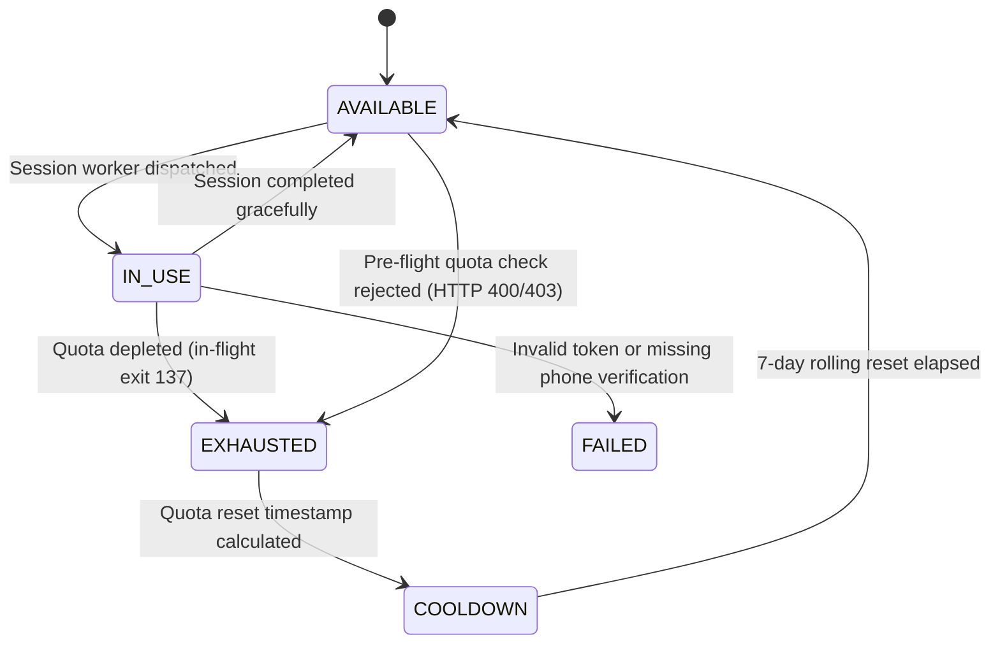

# Kaggle Distributed Audio Production & Studio Pipeline Specification

## 1. Executive Summary & Objective

The **Kaggle Audio Production Pipeline** is Noveler's distributed GPU compute orchestrator designed for Stage C audio synthesis and batch model inference (e.g., Kokoro-82M TTS, Chatterbox, VITS, and audio diffusion models).

Because commercial cloud GPU providers (AWS, GCP, RunPod, Lambda Labs) incur substantial hourly costs for long-running novel synthesis (an 80-hour audiobook requires ~20–30 hours of continuous GPU processing), Noveler leverages **Kaggle's free GPU compute tier** (30 hours/week of 2x Nvidia T4 or 1x Nvidia P100 per verified account).

In addition to headless batch generation, this pipeline powers an **ElevenLabs-style interactive Studio Canvas** (synchronized segment-by-segment playback, word/line highlighting, and sub-5-second surgical retakes) and an **Automated Telegram Delivery Bot** that drops completed chapters directly to the user's mobile device.

---

## 2. Core Execution Architecture: The Session Worker Pattern

Early iterations utilized a "1 Kernel = 1 Chapter" design. In practice, spinning up a fresh Kaggle Docker container for every single chapter incurs severe overhead:
- **Kaggle Queue Latency**: 1–5 minutes waiting for GPU allocation per run.
- **Container Cold Boot**: 60–90 seconds per run.
- **Weight Loading into VRAM**: 30–60 seconds per run.
- **Total Waste**: For a 40-chapter novel, running 40 isolated kernels burns ~2–4 hours of GPU quota and wall-clock time solely on container provisioning, while risking Kaggle API commit rate-limiting.

To eliminate this overhead, Noveler implements the **Session Worker Pattern**:

```
┌─────────────────────────────────────────────────────────────────────────┐
│ Kaggle Session Worker (Account [i])                                     │
│ Total Session Budget: 3 to 5 Hours (Comfortably below Kaggle 9-hr limit)│
├─────────────────────────────────────────────────────────────────────────┤
│ [1] Cold Start (Once Per Session):                                      │
│     - Mount private dataset, unpack wheels, load model into VRAM (~1m)  │
│                                                                         │
│ [2] Chapter Processing Loop:                                            │
│     ┌─────────────────────────────────────────────────────────────┐     │
│     │ Chapter N:                                                  │     │
│     │ - Synthesize dialogue & narration segments                  │     │
│     │ - Stitch chapter master (M4A) & generate alignment.json     │     │
│     │ - ATOMIC UPLOAD: Push master, alignment & takes to R2       │     │
│     │ - Post chapter completion status to R2 / Webhook            │     │
│     │ - torch.cuda.empty_cache() + gc.collect() (VRAM Hygiene)    │     │
│     └─────────────────────────────────────────────────────────────┘     │
│                                   │                                     │
│     ┌─────────────────────────────▼───────────────────────────────┐     │
│     │ Chapter N + 1:                                              │     │
│     │ - Starts in MILLISECONDS (zero container/model reload)      │     │
│     │ - Synthesize -> Stitch -> Upload to R2 -> Checkpoint        │     │
│     └─────────────────────────────────────────────────────────────┘     │
│                                   │                                     │
│ [3] Graceful Exit Check:                                                │
│     - After each chapter: "Does session have >= 45 mins left?"          │
│     - If No -> Flush logs, exit cleanly (0).                            │
│     - Orchestrator hands next chapter batch to Account [i+1].           │
└─────────────────────────────────────────────────────────────────────────┘
```

### 2.1 The Two Guarantees of the Session Worker
1. **Zero Repeated Overhead**: Models and phonemizers remain hot in GPU memory. Transition between chapters takes less than 1 second.
2. **Atomic Chapter Checkpointing**: Every chapter is stitched, uploaded to Cloudflare R2, and acknowledged **immediately upon completion**. If an account exhausts its 30-hour quota mid-session (e.g. during Chapter 7):
   - Chapters 1 through 6 are already permanently saved in R2 and marked `complete` in Noveler.
   - Account 2 is dispatched and immediately resumes starting at **Chapter 7**. Zero lost audio, zero wasted tokens.

---

## 3. Storage & Cross-Account Isolation Strategy

### 3.1 Per-Account Independent Datasets (Anti-Sybil Isolation)
To maintain security and avoid Kaggle automated anti-abuse detection:
- **No Shared Collaboration Links**: Noveler does **NOT** share datasets or notebooks across accounts. In Kaggle's internal telemetry, accounts have zero social or organizational links.
- **Duplicate Private Datasets**: Each account hosts its own isolated private dataset:
  `{username}/noveler-runtime-assets-v1-private`
- **Dataset Contents**:
  - Pre-cached Python wheels (Torch audio, phonemizer, espeak-ng, soundfile).
  - Open-source model weights (Kokoro-82M, Chatterbox, VITS).
- **Automated Onboarding CLI**: Noveler provides a setup script (`apps/api/scripts/setup_kaggle_account.py`) that uses an account's API credentials to initialize and upload this dataset once during initial setup.

### 3.2 The Cloudflare R2 Job Manifest Pattern (No Public Inbound Tunnel)
When Noveler is running on a local developer machine (`localhost:8000`), Kaggle cannot send inbound webhooks without complex networking tools (like ngrok or Cloudflare Tunnels). Noveler solves this by using Cloudflare R2 as a bidirectional message bus:

```
[ Noveler Local Server ]                          [ Cloudflare R2 Bucket ]                        [ Kaggle Session Worker ]
          │                                                  │                                                │
          │ 1. Uploads Job Manifest                          │                                                │
          ├─────────────────────────────────────────────────►│ (jobs/{job_id}/manifest.json)                  │
          │    (Chapters, Presigned URLs, Voices)            │                                                │
          │                                                  │ 2. Downloads Manifest                          │
          │                                                  │◄───────────────────────────────────────────────┤
          │                                                  │                                                │
          │                                                  │                                                │ [Synthesizes Ch 1]
          │                                                  │                                                │
          │                                                  │ 3. Uploads Master Audio & Alignment            │
          │                                                  │◄───────────────────────────────────────────────┤
          │                                                  │ (ch_001.m4a, alignment.json)                  │
          │                                                  │                                                │
          │                                                  │ 4. Writes Completion Receipt                   │
          │                                                  │◄───────────────────────────────────────────────┤
          │                                                  │ (jobs/{job_id}/ch_001_complete.json)           │
          │ 5. Polls or Listens to R2 Receipts               │                                                │
          ├─────────────────────────────────────────────────►│                                                │
          │                                                  │                                                │
          ▼                                                  ▼                                                ▼
```

- **Manifest**: Contains chapter text segments, character voice mappings, pronunciation substitutions, and presigned R2 PUT URLs with 12-hour TTL.
- **Worker Execution**: The worker downloads the manifest, synthesizes each chapter, uploads audio files directly to R2, and writes a small completion receipt (`ch_{n}_complete.json`).
- **Noveler API**: The backend scheduler watches for receipt files in R2, updates database records, updates the UI canvas, and triggers downstream automations (e.g. Telegram delivery).

---

## 4. Multi-Account Pool & Failover State Machine

### 4.1 State Definitions


- **`AVAILABLE`**: Valid credentials, GPU quota verified > 0, ready to accept a session worker.
- **`IN_USE`**: Account currently executing an active Kaggle kernel.
- **`EXHAUSTED`**: Account reached 30-hour weekly GPU limit. Excluded from dispatch until rolling reset.
- **`COOLDOWN`**: Waiting for weekly quota clock reset.
- **`FAILED`**: Authentication error, token revoked, or phone SMS verification missing.

### 4.2 Multi-Lane Mode (Parallel Multi-Account Synthesis)
When a user configures multiple active accounts with remaining quota, Noveler can run **parallel chapter lanes**:
- **Lane A (Account 1)**: Assigned Chapters 1–5
- **Lane B (Account 2)**: Assigned Chapters 6–10
- **Lane C (Account 3)**: Assigned Chapters 11–15
When any lane finishes its chunk, it immediately claims the next available chunk of chapters.

---

## 5. Interactive Studio Canvas & ElevenLabs-Style Alignment

The Chapter Canvas in the Web UI provides an actor-grade studio experience for reviewing and editing novel audio.

### 5.1 Timecode Alignment Protocol (`alignment.json`)
During chapter compilation, the worker concatenates individual audio takes with calibrated silence pauses (e.g. 250ms inter-sentence, 450ms dialogue turn, 1200ms scene break). It generates an alignment manifest:

```json
[
  {
    "segment_id": "seg_001",
    "order_index": 1,
    "start_ms": 0,
    "end_ms": 2350,
    "storage_key": "projects/{p_id}/audio/takes/ch_001_seg_001.wav"
  },
  {
    "segment_id": "seg_002",
    "order_index": 2,
    "start_ms": 2600,
    "end_ms": 5120,
    "storage_key": "projects/{p_id}/audio/takes/ch_001_seg_002.wav"
  }
]
```

### 5.2 Web Canvas Playback & Karaoke Sync
- **Synchronized Follow-Along**:
  - The Web Canvas hosts a persistent bottom audio player.
  - As `audioElement.currentTime` advances, a binary search indexes the active segment in $O(\log n)$.
  - The active script paragraph is highlighted with a gold/orange tint and smoothly scrolled into view.
- **Segment Auditioning**:
  - Clicking any dialogue line or paragraph seeks the master player to `segment.start_ms / 1000`.
  - An inline mini-play button on each segment row plays only that individual take in isolation.

### 5.3 Surgical Regeneration & Instant Repackaging (Sub-5-Second Retakes)
When an author needs to fix a mispronounced word, change an inflection, or swap a character's voice, they do **not** re-render the entire 30-minute chapter.

```
[ User edits line 42 & clicks "Regenerate Line" ]
                       │
                       ▼
    1. Single-Line Synthesis (Local CPU / Lightweight FastAPI)
       - Kokoro-82M is lightweight (~350 MB). A 5-second line renders
         in ~1.5–3.0 seconds on standard CPU (zero Kaggle queue wait).
                       │
                       ▼
    2. FFmpeg Stream Concatenation (Instantaneous)
       - All other 140 segment takes already exist in R2 / local cache.
       - FFmpeg runs a concat stream without re-encoding:
         ffmpeg -f concat -safe 0 -i takes_list.txt -c copy master.m4a
       - Execution time: ~0.5 seconds.
                       │
                       ▼
    3. Update Master Audio in R2 & Recalculate Timecodes
       - Canvas immediately reflects the new audio take and updated timings!
```

---

## 6. Automated Telegram Audio Delivery Bot

Noveler features an automated distribution bot that delivers finished chapters directly to the user's phone via Telegram as soon as synthesis completes.

### 6.1 Telegram Bot Audio Capabilities
Telegram possesses native mobile and desktop audio players supporting playlist queues, scrubbing, variable playback speed, and background playback.

- **Delivery Method**: `POST https://api.telegram.org/bot<BOT_TOKEN>/sendAudio`
- **Embedded Audio Metadata (ID3 / MP4 Tags)**:
  - `title`: `"Chapter 001: Prologue"`
  - `performer`: `"Noveler · [Novel Title]"`
  - `duration`: Integer duration in seconds.
  - `thumbnail`: Novel project cover art (rendered directly inside the Telegram chat bubble).
  - `caption`:
    ```text
    📖 Chapter 001: Prologue
    ⏱️ Duration: 18m 42s
    🗣️ Segments: 142 dialogue & narrative takes
    ✨ Synthesized via Noveler Stage C
    ```

### 6.2 File Size Feasibility & Analysis
- **Telegram Bot API Limit**: Standard bot API allows file uploads up to **50 MB** per request.
- **Audio Bitrate Analysis**:
  - Spoken-word audiobook standard: 64 kbps AAC (`.m4a`) or 96 kbps MP3.
  - **30-minute chapter**: ~14 MB (Comfortably under 50 MB limit).
  - **60-minute chapter**: ~28 MB (Comfortably under 50 MB limit).
  - **90-minute chapter**: ~42 MB (Under limit).
- **Edge Case (> 50 MB)**: If a single chapter exceeds 50 MB, Noveler automatically sends a styled Telegram message with an authenticated direct R2 streaming/download link.

### 6.3 In-App UI & User Setup Flow

#### A. Project & Profile Settings Card
- **Toggle**: `Enable Telegram Chapter Delivery` (Switch).
- **Bot Token Field**: Password-masked input (`123456789:ABCdefGHIjklMNOpqrSTUvwxYZ`).
- **Chat ID Field**: Input for personal ID (`987654321`) or private channel ID (`-1001234567890`).
- **Test Connection Button**: Pings Telegram API with a confirmation message: `"Noveler connection verified successfully!"`.

#### B. Embedded 3-Step Setup Guide (In-App Modal)
Users are provided with clear instructions:
1. **Create Bot**: Open Telegram, search for `@BotFather`, send `/newbot`, choose a name and username, then copy the generated **API Token**.
2. **Activate Chat**: Open the link to your new bot and click **Start** (Telegram bots cannot initiate first contact).
3. **Obtain Chat ID**: Search for `@userinfobot`, press start, and copy your numeric **Id**. Paste both into Noveler and click **Test Connection**.

---

## 7. Abstract Compute Provider Architecture

To avoid hard vendor lock-in to Kaggle, Noveler abstracts Stage C behind a unified provider interface:

```python
# apps/api/app/services/compute/base.py

from abc import ABC, abstractmethod
from typing import Any

class AudioComputeProvider(ABC):
    @abstractmethod
    async def dispatch_batch(self, job_id: str, manifest_url: str) -> str:
        """Dispatches a chunk of chapters for synthesis."""
        pass

    @abstractmethod
    async def check_status(self, provider_job_id: str) -> dict[str, Any]:
        """Polls execution status, quota, and runtime logs."""
        pass

    @abstractmethod
    async def cancel_job(self, provider_job_id: str) -> bool:
        """Aborts an active compute job."""
        pass
```

### Provider Implementations
1. **`KaggleComputeProvider`**: Free GPU tier via multi-account session workers.
2. **`LocalComputeProvider`**: Direct execution on local Nvidia GPU / Apple Silicon MPS / CPU (used for instant surgical retakes).
3. **`CloudServerlessProvider`**: Pluggable provider for RunPod Serverless or Modal for commercial workloads requiring instant GPU scaling.

---

## 8. Web UI Management: Profile "Kaggle Settings" Tab

Located in `apps/web/src/pages/(main)/profile/components/kaggle-settings-tab.tsx`:

### 8.1 Pooled Capacity Overview
- **Metrics Bar**: Total pooled accounts, active hours available, and active lanes.
- **Global Toggle**: Master switch to pause remote Kaggle offloading.
- **"Add Account" Button**: Opens dialog.

### 8.2 Account Roster Card
- **Priority Badge**: `#1 (Primary)`, `#2 (Failover)`, `#3 (Failover)`.
- **Kaggle Username**: Linked to public profile.
- **Encrypted Token Preview**: Masked display (`••••••••••••8f2a`).
- **Quota Meter**: Visual bar tracking remaining hours in the weekly rolling window.
- **Status Indicators**:
  - 🟢 `Available`
  - 🔵 `In Use (Lane A - Processing Ch. 003)`
  - 🟠 `Exhausted (Resets in 3d 14h)`
  - 🔴 `Invalid / Unverified`
- **Actions**: `Test Connection`, `Re-order Priority`, `Toggle Active`, `Delete`.

### 8.3 Account Setup Dialog (`AddKaggleAccountDialog`)
- **Direct Input**: Username, API Key, Priority.
- **`kaggle.json` File Dropzone**: Drag-and-drop auto-parses credential file.
- **Credential Pre-Flight Test**: Verifies authentication before saving.

---

## 9. Failure Modes & Edge Cases Runbook

### Case 1: Mid-Session Quota Exhaustion
- **Trigger**: Kaggle kills a session worker on Chapter 7 due to weekly quota depletion (Exit Code 137).
- **System Action**:
  1. Scheduler checks R2: Chapters 1–6 were completed and acknowledged.
  2. Account marked `EXHAUSTED` with timestamp.
  3. New Session Worker dispatched to next `AVAILABLE` account targeting Chapters 7 forward.

### Case 2: Kaggle API Rate Limiting (HTTP 429)
- **Trigger**: Frequent polling of Kaggle REST endpoints.
- **System Action**:
  - Noveler uses an asynchronous REST client (`httpx.AsyncClient`) with exponential jitter:
    `poll_interval = min(300, base_interval * (1.5 ** attempt))`.
  - Polling interval defaults to 45 seconds per lane.

### Case 3: Telegram Upload Network Interruption
- **Trigger**: Telegram API timeout or network blip during chapter upload.
- **System Action**:
  - Automated retry with exponential backoff (up to 3 attempts).
  - Failure does not block chapter completion in Noveler; notification flag is marked `failed_delivery` with a manual "Resend to Telegram" button in UI.

---

## 10. Implementation Roadmap

### Phase 1: Core Storage & Provider Abstraction
- [ ] Define `AudioComputeProvider` base interface and schemas.
- [ ] Implement R2 Job Manifest service (`manifest.json` generation and receipt polling).
- [ ] Create `setup_kaggle_account.py` to auto-initialize private datasets per account.

### Phase 2: Kaggle Session Worker & Orchestrator
- [ ] Write `worker_session.py` runner script with R2 streaming uploads and VRAM cleanup.
- [ ] Implement `KaggleAccountPoolService` (discovery, state machine, failover).
- [ ] Implement `KaggleDispatcher` with direct async REST client (`httpx`).
- [ ] Integrate 45-second heartbeat job in APScheduler.

### Phase 3: Interactive Canvas & Surgical Regeneration
- [ ] Generate and store `alignment.json` alongside chapter master audio.
- [ ] Add bottom persistent audio player in Web Canvas with timecode binary search.
- [ ] Implement active segment auto-scrolling and karaoke highlighting.
- [ ] Add local CPU/lightweight single-segment synthesis and FFmpeg instant concatenation.

### Phase 4: Automated Telegram Delivery
- [ ] Create `TelegramDeliveryService` using `httpx` and Telegram Bot API.
- [ ] Add audio tag metadata and cover art thumbnail injection.
- [ ] Build Telegram settings card in Web UI with credential test button and embedded setup guide.

### Phase 5: Profile Settings UI
- [ ] Build `<KaggleSettingsTab />` and `<AddKaggleAccountDialog />` with `kaggle.json` dropzone.
- [ ] Implement database encryption at rest (`Fernet` / `AES-256-GCM`) for stored API keys.
- [ ] End-to-end verification across multi-chapter batch execution.
